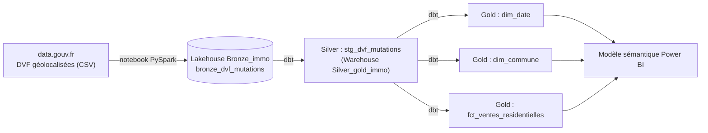

# dvf-fabric-dbt

Projet Analytics Engineering de bout en bout : ingestion des données DVF (ventes immobilières, open data) dans un Lakehouse Microsoft Fabric, transformation avec **dbt** (dbt job natif de Fabric) vers un Warehouse, versioning sur GitHub.

L'objectif est de passer de fichiers bruts à des tables fiables, documentées et testées, organisées en schéma en étoile et prêtes à être consommées dans Power BI.

## Architecture



Architecture Médaillon :

| Couche | Emplacement | Contenu |
|---|---|---|
| Bronze | Lakehouse `Bronze_immo` | Données brutes en texte, avec colonnes techniques (`_source_file`, `_ingested_at`) |
| Silver | Warehouse `Silver_gold_immo`, schéma `silver` | Données nettoyées et typées (vue `stg_dvf_mutations`) |
| Gold | Warehouse `Silver_gold_immo`, schéma `gold` | Schéma en étoile : une table de faits et deux dimensions |

## Données

- Source : DVF géolocalisées (Demandes de valeurs foncières), open data, data.gouv.fr.
- Périmètre : année 2022, départements 75, 91, 92, 93 et 94, soit environ 356 000 lignes dans la couche Bronze.

## Stack

- Microsoft Fabric : Lakehouse, Warehouse, notebook PySpark, dbt job (préversion)
- dbt Core avec l'adaptateur dbt-fabric
- GitHub pour le versioning
- Power BI pour la couche de restitution (à venir)

## Structure du dépôt

```
.
├── dbt_project.yml
├── macros/
│   └── generate_schema_name.sql     # écrit dans les schémas silver / gold tels quels
├── models/
│   ├── staging/
│   │   ├── _sources.yml             # source Bronze (Lakehouse Bronze_immo)
│   │   ├── stg_dvf_mutations.sql
│   │   └── test_staging.yml
│   └── marts/
│       ├── dim_date.sql
│       ├── dim_commune.sql
│       ├── fct_ventes_residentielles.sql
│       └── test_marts.yml
├── notebooks/
│   └── 01_ingestion_bronze_dvf.ipynb
└── docs/images/lineage.png          # graphe de lignage
```

## Lignage


## Etat des executions


## Choix de modélisation

**Le grain du DVF.** Une mutation (une vente) peut comporter plusieurs lignes, une par local ou par parcelle, et la valeur foncière est répétée sur chacune. Additionner cette colonne telle quelle fausse les montants. La table de faits est donc au grain « une mutation » : elle ne garde que les ventes de maisons et d'appartements, avec un prix et une surface renseignés, et uniquement les mutations qui comportent un seul local. Le prix au m² est alors fiable.

Cette règle est une simplification assumée : les ventes multi-locaux sont écartées.

**Une dimension calendrier issue des données.** `dim_date` est construite à partir des dates présentes dans les données. Cela évite les CTE récursives, dont la prise en charge dans le Warehouse Fabric n'est pas garantie.

**Types compatibles avec le Warehouse Fabric.** Le Warehouse n'accepte pas `nvarchar`. Les libellés de mois sont donc produits par un `case` plutôt que par `datename`, qui renvoie du `nvarchar`.

**Schémas explicites.** La macro `generate_schema_name` envoie les modèles dans `silver` et `gold`, sans préfixe.

## Qualité des données

Des tests dbt sont définis sur chaque couche :

- `not_null` sur `id_mutation` et `date_mutation` (Silver)
- `unique` et `not_null` sur les clés des dimensions et sur `id_mutation` dans la table de faits
- `relationships` entre la table de faits et les dimensions
- `accepted_values` sur `type_local` (`Maison`, `Appartement`)

## Reproduire le projet

1. Créer dans Fabric un workspace, un Lakehouse `Bronze_immo` et un Warehouse `Silver_gold_immo`.
2. Importer le notebook `notebooks/01_ingestion_bronze_dvf.ipynb`, l'attacher au Lakehouse `Bronze_immo` et l'exécuter. Il crée la table `bronze_dvf_mutations`.
3. Activer le paramètre de tenant « dbt jobs (preview) », puis créer un dbt job relié au Warehouse `Silver_gold_immo` avec le schéma `silver`.
4. Copier dans le dbt job les fichiers de ce dépôt (`dbt_project.yml`, `macros/`, `models/`).
5. Lancer la commande `build`.

## Limites et pistes d'amélioration

- Une seule année est chargée. Ajouter les années suivantes demande de compléter l'ingestion.
- Les valeurs extrêmes du prix au m² ne sont pas encore filtrées.
- Les sources ne sont pas encore contrôlées par des tests de fraîcheur.
- La synchronisation entre Fabric et GitHub est manuelle. L'intégration Git du workspace n'a pas pu être activée sur mon tenant.
- Prochaine étape : modèle sémantique et rapport Power BI sur la couche Gold.
