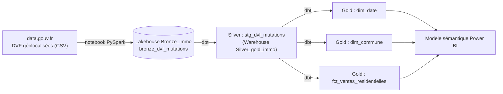

# dvf-fabric-dbt

Projet Analytics Engineering de bout en bout : ingestion des données DVF (ventes immobilières, open data) dans un Lakehouse Microsoft Fabric, transformation avec **dbt** (dbt job natif de Fabric) vers un Warehouse, versioning sur GitHub.

L'objectif est de passer de fichiers bruts à des tables fiables, documentées et testées, organisées en schéma en étoile et prêtes à être consommées dans Power BI.

## Architecture



Architecture Médaillon :

| Couche | Emplacement | Contenu |
|---|---|---|
| Bronze | Lakehouse `Bronze_immo` | Données brutes en texte, avec colonnes techniques (`_source_file`, `_ingested_at`) |
| Silver | Warehouse `Silver_gold_immo`, schéma `silver` | Données nettoyées et typées (vue `stg_dvf_mutations`) |
| Gold | Warehouse `Silver_gold_immo`, schéma `gold` | Schéma en étoile : une table de faits et deux dimensions |

## Données

- Source : DVF géolocalisées (Demandes de valeurs foncières), open data, data.gouv.fr.
- Périmètre : années 2022 à 2024, départements 75, 91, 92, 93 et 94.
- Volumes : 918 125 lignes dans la couche Bronze (356 324 en 2022, 290 341 en 2023, 271 460 en 2024), qui donnent 262 873 ventes dans la table de faits Gold.

## Stack

- Microsoft Fabric : Lakehouse, Warehouse, notebook PySpark, dbt job (préversion)
- dbt Core avec l'adaptateur dbt-fabric
- GitHub pour le versioning
- Power BI : modèle sémantique et rapport de trois pages sur la couche Gold

## Structure du dépôt

```
.
├── dbt_project.yml
├── macros/
│   └── generate_schema_name.sql     # écrit dans les schémas silver / gold tels quels
├── models/
│   ├── staging/
│   │   ├── _sources.yml             # source Bronze (Lakehouse Bronze_immo)
│   │   ├── stg_dvf_mutations.sql
│   │   └── test_staging.yml
│   └── marts/
│       ├── dim_date.sql
│       ├── dim_commune.sql
│       ├── fct_ventes_residentielles.sql
│       └── test_marts.yml
├── notebooks/
│   └── 01_ingestion_bronze_dvf.ipynb
└── docs/images/                     # captures : lignage dbt et rapport Power BI
```

## Lignage


### Rapport Power BI

Le rapport s'appuie sur un modèle sémantique construit sur les trois tables Gold (`fct_ventes_residentielles`, `dim_date`, `dim_commune`), reliées par `date_key` et `commune_key`. Il compte trois pages et des filtres communs : département, type de local, année et mois.

### Vue d'ensemble


Indicateurs clés (nombre de ventes, prix m² médian avec sa variation par rapport au mois précédent, surface moyenne, valeur totale), évolution mensuelle du prix m² médian et nombre de ventes par département.

### Communes


Classement des communes par prix m² médian, avec le nombre de ventes et la surface moyenne, et répartition des ventes par tranche de prix au m². Les tranches sont calculées dans dbt, dans la table de faits.

### Maison vs Appartement


Comparaison côte à côte des deux types de local : nombre de ventes, prix m² médian, surface moyenne et nombre moyen de pièces, puis évolution mensuelle et prix par département.

### Principales mesures DAX

- `Nb ventes` : nombre de lignes de la table de faits, soit le nombre de ventes puisque le grain est une mutation.
- `Prix m² médian` : médiane du prix au m².
- `Variation prix m² vs M-1` : variation par rapport au mois précédent, calculée à partir d'un index année × 12 + mois. Elle fonctionne même si la dimension calendrier a des trous, et ne s'affiche que lorsqu'un seul mois est sélectionné.
- `% ventes par tranche` : part des ventes de chaque tranche de prix au m², pour la sélection en cours.

## Choix de modélisation

**Le grain du DVF.** Une mutation (une vente) peut comporter plusieurs lignes, une par local ou par parcelle, et la valeur foncière est répétée sur chacune. Additionner cette colonne telle quelle fausse les montants. La table de faits est donc au grain « une mutation » : elle ne garde que les ventes de maisons et d'appartements, avec un prix et une surface renseignés, et uniquement les mutations qui comportent un seul local. Le prix au m² est alors fiable.

Cette règle est une simplification assumée : les ventes multi-locaux sont écartées.

**Une dimension calendrier issue des données.** `dim_date` est construite à partir des dates présentes dans les données. Cela évite les CTE récursives, dont la prise en charge dans le Warehouse Fabric n'est pas garantie.

**Types compatibles avec le Warehouse Fabric.** Le Warehouse n'accepte pas `nvarchar`. Les libellés de mois sont donc produits par un `case` plutôt que par `datename`, qui renvoie du `nvarchar`.

**Schémas explicites.** La macro `generate_schema_name` envoie les modèles dans `silver` et `gold`, sans préfixe.

## Qualité des données

Des tests dbt sont définis sur chaque couche :

- `not_null` sur `id_mutation` et `date_mutation` (Silver)
- `unique` et `not_null` sur les clés des dimensions et sur `id_mutation` dans la table de faits
- `relationships` entre la table de faits et les dimensions
- `accepted_values` sur `type_local` (`Maison`, `Appartement`)

## Reproduire le projet

1. Créer dans Fabric un workspace, un Lakehouse `Bronze_immo` et un Warehouse `Silver_gold_immo`.
2. Importer le notebook `notebooks/01_ingestion_bronze_dvf.ipynb`, l'attacher au Lakehouse `Bronze_immo` et l'exécuter. Il crée la table `bronze_dvf_mutations`.
3. Activer le paramètre de tenant « dbt jobs (preview) », puis créer un dbt job relié au Warehouse `Silver_gold_immo` avec le schéma `silver`.
4. Copier dans le dbt job les fichiers de ce dépôt (`dbt_project.yml`, `macros/`, `models/`).
5. Lancer la commande `build`.
6. Créer un modèle sémantique sur les tables `gold.fct_ventes_residentielles`, `gold.dim_date` et `gold.dim_commune`, avec les relations sur `date_key` et `commune_key`, puis construire le rapport Power BI. Le fichier du rapport n'est pas versionné dans ce dépôt, seules les captures le sont.

## Limites et pistes d'amélioration

- Trois années sont chargées (2022 à 2024). Ajouter d'autres années ou départements demande de compléter la liste dans le notebook d'ingestion.
- Les valeurs extrêmes du prix au m² ne sont pas encore filtrées.
- Les sources ne sont pas encore contrôlées par des tests de fraîcheur.
- La synchronisation entre Fabric et GitHub est manuelle. L'intégration Git du workspace n'a pas pu être activée sur mon tenant.
- Le fichier du rapport Power BI n'est pas versionné. Un export au format projet Power BI (PBIP) permettrait de le suivre dans Git.

