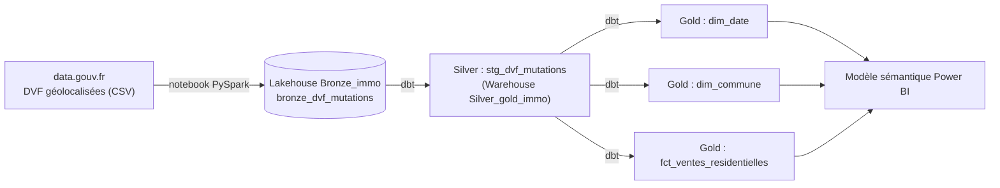
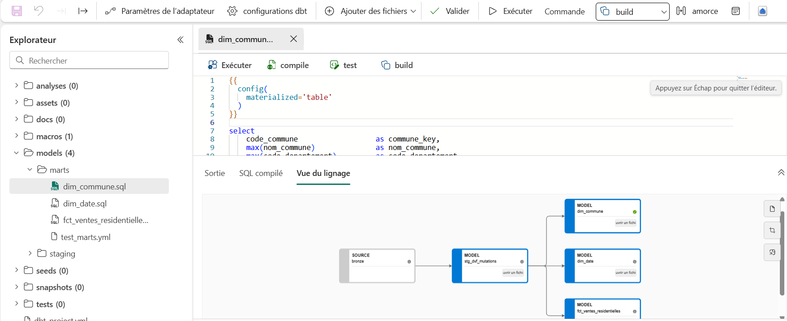

# dvf-fabric-dbt

Projet Analytics Engineering de bout en bout : ingestion des données DVF (ventes immobilières, open data) dans un Lakehouse Microsoft Fabric, transformation avec **dbt** (dbt job natif de Fabric) vers un Warehouse, versioning sur GitHub.

L'objectif est de passer de fichiers bruts à des tables fiables, documentées et testées, organisées en schéma en étoile et prêtes à être consommées dans Power BI.

## Architecture



Architecture Médaillon :

| Couche | Emplacement | Contenu |
|---|---|---|
| Bronze | Lakehouse `Bronze_immo` | Données brutes en texte, avec colonnes techniques (`_source_file`, `_ingested_at`) |
| Silver | Warehouse `Silver_gold_immo`, schéma `silver` | Données nettoyées et typées (vue `stg_dvf_mutations`) |
| Gold | Warehouse `Silver_gold_immo`, schéma `gold` | Schéma en étoile : une table de faits et deux dimensions |

## Données

- Source : DVF géolocalisées (Demandes de valeurs foncières), open data, data.gouv.fr.
- Périmètre : années 2022 à 2024, départements 75, 91, 92, 93 et 94.
- Volumes : 918 125 lignes dans la couche Bronze (356 324 en 2022, 290 341 en 2023, 271 460 en 2024), qui donnent 262 873 ventes dans la table de faits Gold.

## Stack

- Microsoft Fabric : Lakehouse, Warehouse, notebook PySpark, dbt job (préversion)
- dbt Core avec l'adaptateur dbt-fabric
- GitHub pour le versioning
- Power BI : modèle sémantique et rapport de trois pages sur la couche Gold

## Structure du dépôt


## Structure du dépôt

```
.
├── dbt_project.yml
├── macros/
│   └── generate_schema_name.sql     # écrit dans les schémas silver / gold tels quels
├── models/
│   ├── staging/
│   │   ├── _sources.yml             # source Bronze (Lakehouse Bronze_immo)
│   │   ├── stg_dvf_mutations.sql
│   │   └── test_staging.yml
│   └── marts/
│       ├── dim_date.sql
│       ├── dim_commune.sql
│       ├── fct_ventes_residentielles.sql
│       └── test_marts.yml
├── notebooks/
│   └── 01_ingestion_bronze_dvf.ipynb
└── docs/images/                     # captures : lignage dbt et rapport Power BI
```

## Lignage et Rapport Power BI



Le rapport s'appuie sur un modèle sémantique construit sur les trois tables Gold (`fct_ventes_residentielles`, `dim_date`, `dim_commune`), reliées par `date_key` et `commune_key`, et se divise en trois pages principales (Vue d'ensemble, Communes, Maison vs Appartement) illustrées ci-dessous :

- **Vue d'ensemble** : 
- **Communes** : 
- **Maison vs Appartement** : 

### Principales mesures DAX et Modélisation
Les mesures clés incluent `Nb ventes`, `Prix m² médian`, `Variation prix m² vs M-1` et `% ventes par tranche`. Côté modélisation, le grain de la table de faits est positionné à « une mutation » (ventes uniques d'appartements ou maisons) pour garantir la fiabilité des prix au m², tandis que `dim_date` est générée directement à partir des données sources pour s'adapter aux limitations des CTE récursives du Warehouse Fabric.

## Qualité des données et Reproduction

Des tests dbt sont appliqués sur chaque couche (not_null, unique, relationships, accepted_values). Pour reproduire le projet, créez l'espace de travail et les stockages sur Microsoft Fabric, exécutez le notebook d'ingestion PySpark, configurez le dbt job avec les modèles du dépôt, puis finalisez avec la création du modèle sémantique et du rapport Power BI.

## Limites et perspectives
Le projet charge actuellement les années 2022 à 2024 sur une sélection de départements franciliens. Les axes d'amélioration incluent l'automatisation de la synchronisation Git, le filtrage des valeurs extrêmes et le versioning complet du fichier Power BI (au format PBIP).

🚀 Commandes pour envoyer la modification :

Une fois le fichier enregistré (Ctrl + S), exécutez la séquence suivante dans votre terminal :
bash
git add .
git commit -m "Fix: correction des chemins relatifs des images du README"
git push origin main
Utilisez le code avec précaution.
Maintenant que le préfixe ./ est en place et que les syntaxes d'images ont été nettoyées, les graphiques Power BI s'affichent-ils correctement sur votre page GitHub ?
Les réponses de l'IA peuvent contenir des erreurs. En savoir plus

- Le fichier du rapport Power BI n'est pas versionné. Un export au format projet Power BI (PBIP) permettrait de le suivre dans Git.

